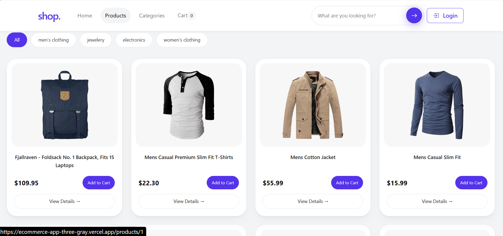
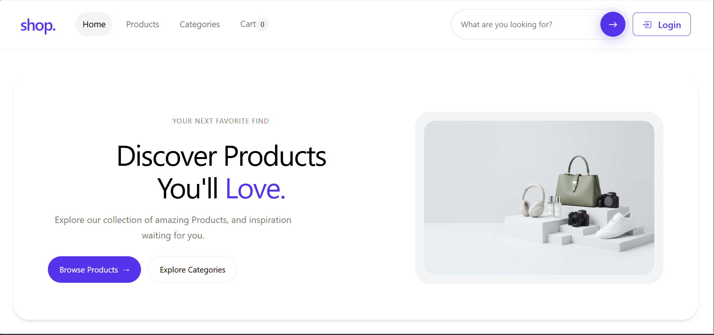

# 🛒 E-commerce Web Application

A responsive e-commerce web application built with React, Redux Toolkit, and React Router. Users can browse products, filter by category, manage their shopping cart, and navigate through the application with authentication and protected routes.

## 🚀 Live Demo

[View Live Application](https://ecommerce-app-three-gray.vercel.app/home)

## 📸 Screenshots




## ✨ Features

- Browse products fetched from Fake Store API.
- Filter products by category.
- Paginated product listings.
- View detailed product information.
- Add products to the shopping cart.
- Increase and decrease product quantities.
- Remove products from the cart.
- User login and registration.
- Protected routes for authenticated users.
- Responsive UI.

## 🛠️ Technologies Used

- React.js
- JavaScript (ES6+)
- Redux Toolkit
- React Redux
- React Router
- React Bootstrap
- Bootstrap
- Bootstrap Icons
- CSS3
- Fake Store API

## 📦 Installation & Setup

1. Clone the repository:

   ```bash
   git clone https://github.com/mohammedsaeed090909-ship-it/ecommerce-app.git
   ```

2. Navigate to the project directory:

   ```bash
   cd ecommerce-app
   ```

3. Install dependencies:

   ```bash
   npm install
   ```

4. Start the development server:

   ```bash
   npm start
   ```

5. Open the application:

   ```text
   http://localhost:3000
   ```

## 🔗 API

This application uses [Fake Store API](https://fakestoreapi.com/) to fetch product data and simulate authentication and shopping cart operations.

## 👨‍💻 Author

**Mohamed Saeed Salama**

- [GitHub Profile](https://github.com/mohammedsaeed090909-ship-it)
- [LinkedIn](https://www.linkedin.com/in/mohamed-saeed-085735410/)
